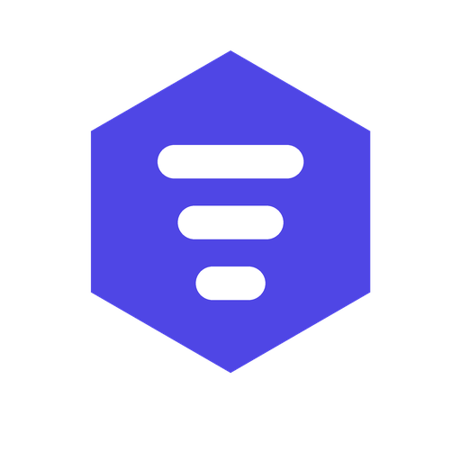
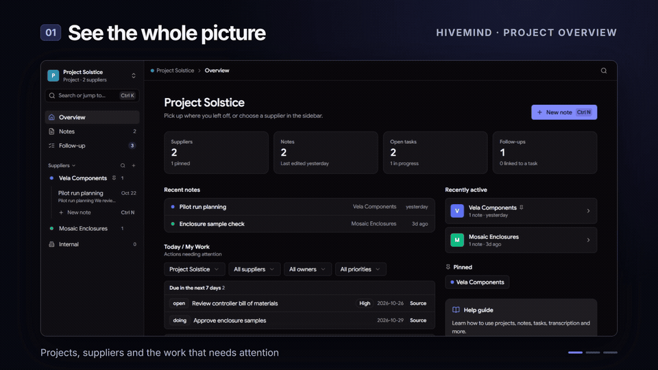

<div align="center">
  
  <h1>HiveMind</h1>
  <p><strong>From meeting notes to momentum.</strong></p>
  <p>Keep supplier conversations, decisions and follow-ups connected in one desktop workspace.</p>
  <p>
    <a href="https://github.com/diskuskastaren/HiveMind/releases/latest"><strong>Download for Windows</strong></a>
    &nbsp;·&nbsp;
    <a href="https://diskuskastaren.github.io/HiveMind/"><strong>Try the interactive demo</strong></a>
  </p>
</div>

<br />

<div align="center">
  <a href="https://diskuskastaren.github.io/HiveMind/">
    
  </a>
  <p><sub>Play and seek the HyperFrames tour, then click through a live HiveMind workspace. All demo data is fictional.</sub></p>
</div>

## What you can do

| Capture | Follow through |
| --- | --- |
| Organize notes by project and supplier, with rich text and attachments. | Keep tasks, owners, due dates and follow-ups tied to their source notes. |
| Record or import transcripts and review AI suggestions before saving them. | Track decisions and their history as work changes. |
| Find notes, tasks and decisions with search. | See what needs attention in **Today / My Work** and the follow-up board. |

HiveMind stores its workspace locally and makes automatic backups. You can also export project data as JSON. Transcription and AI analysis use Groq or OpenAI only when you configure the relevant API keys and run those features.

## Install

Download the latest `HiveMind-Setup-*.exe` from [Releases](https://github.com/diskuskastaren/HiveMind/releases/latest). The current installer targets Windows x64.

1. Create a project.
2. Add a supplier and open a note.
3. Capture the meeting, then add tasks, decisions and follow-ups.
4. Open **Overview** or **Follow-up** to see the work across suppliers.

If you used an earlier version of the app, your existing data is kept in the same Windows profile at `%APPDATA%\supplier-notes`.

## Develop locally

Requires Node.js 22 or newer. From the [`supplier-notes`](supplier-notes) directory:

```bash
npm install
npm run electron:dev
```

Useful checks:

```bash
npm run typecheck
npm test
npm run electron:build
```

The [interactive demo](https://diskuskastaren.github.io/HiveMind/) uses a real [HyperFrames composition](supplier-notes/docs/demo/hivemind-tour/index.html) and [`@hyperframes/player`](https://github.com/heygen-com/hyperframes/tree/main/packages/player) for playback, seeking and scene navigation. Its **Explore live workspace** tab runs the browser build of HiveMind with [fictional sample data](supplier-notes/docs/demo/fixture.mjs). The [demo source and rebuild steps](supplier-notes/docs/demo/README.md) are included in this repository.
